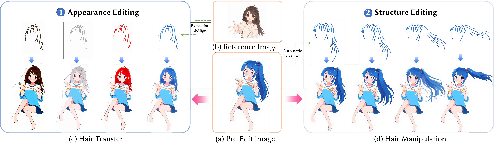

# Structure–Color Disentangled Anime Hair Synthesis via Flow Line

**SIGGRAPH Asia 2026**

Tianyu Zhang, I-Chao Shen, Haoran Xie

[](https://zty0304.github.io/FlowLines-web/)
[](https://doi.org/10.1145/3829340.3842227)



## Overview

This is the official repository for our SIGGRAPH Asia 2026 paper,
**Structure–Color Disentangled Anime Hair Synthesis via Flow Line**.
We introduce **Flow Line**, a sparse and intuitive representation
that captures the fine-grained structure and color intent of anime
hairstyles.
Our framework enables independent control of hair structure and
color, supporting flexible hairstyle synthesis, transfer,
and manipulation.

## Release Status

- [x] Dataset
- [x] Flow line extraction code
- [ ] Models and checkpoints


## Dataset

We release the **Flow Line Dataset** associated with our paper.
The flow line annotations were manually drawn by artists to
capture the structure and color of anime hairstyles.

### Download

- [Flow Line Dataset](https://jstorage.box.com/s/v8lc0jymfcud9kmhelhywkit42owpksy)
- [Danbooru Image Metadata (CSV)](dataset/metadata.csv)

### Copyright Notice

Due to copyright restrictions, we do not redistribute the
original images sourced from Danbooru. Please refer to the
provided CSV file to retrieve the corresponding images,
subject to their respective copyright and usage restrictions.


## Flow Line Extraction

Drawing hair flow lines by hand takes a lot of time, which makes the dataset hard to extend to new images. To make it easier to use, we trained a [model](FlowLineEx/) on the human-drawn flow lines in our dataset. Given an anime illustration and its hair mask, it automatically extracts hair flow lines as vector curves (SVG).

The code and pretrained weights are in [`FlowLineEx/flow_line_ex/`](FlowLineEx/flow_line_ex/). See [its README](FlowLineEx/flow_line_ex/README.md) for installation and usage.


## Citation

If you find our work or dataset useful in your research,
please consider citing our paper:

```bibtex
@article{zhang2026flowline,
  title={Structure--Color Disentangled Anime Hair Synthesis via Flow Line},
  author={Zhang, Tianyu and Shen, I-Chao and Xie, Haoran},
  journal={ACM Transactions on Graphics},
  year={2026},
  doi={10.1145/3829340.3842227}
}
```

## Acknowledgments

We thank all participants who contributed to the creation
of our flow line annotations.

